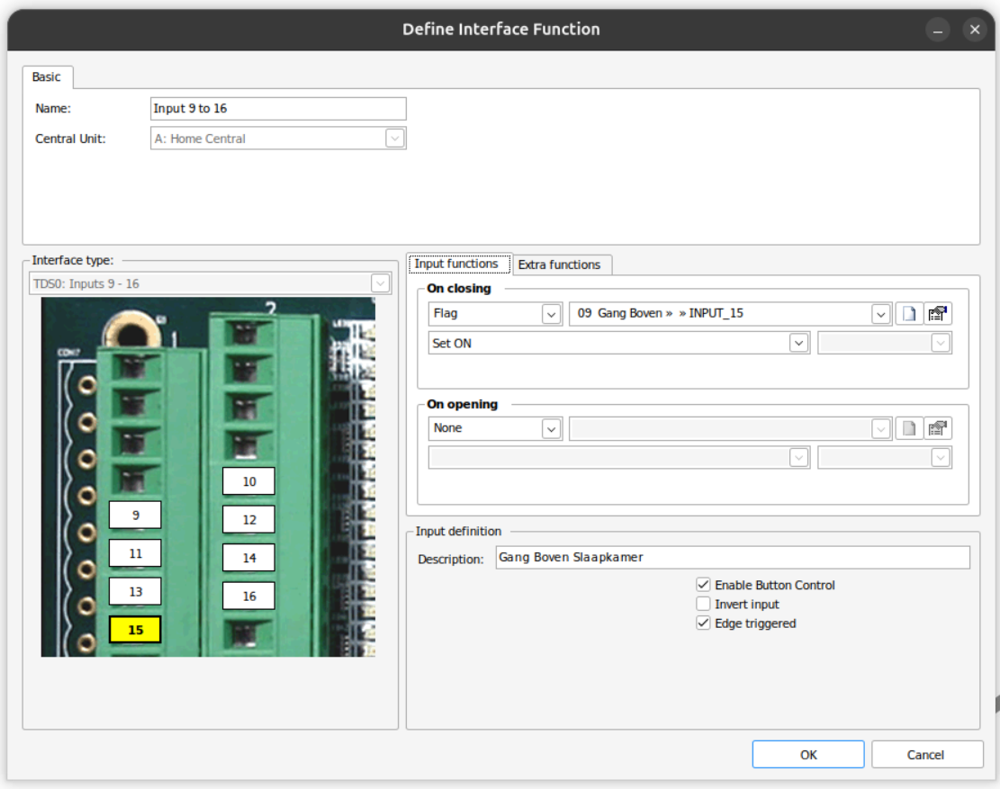
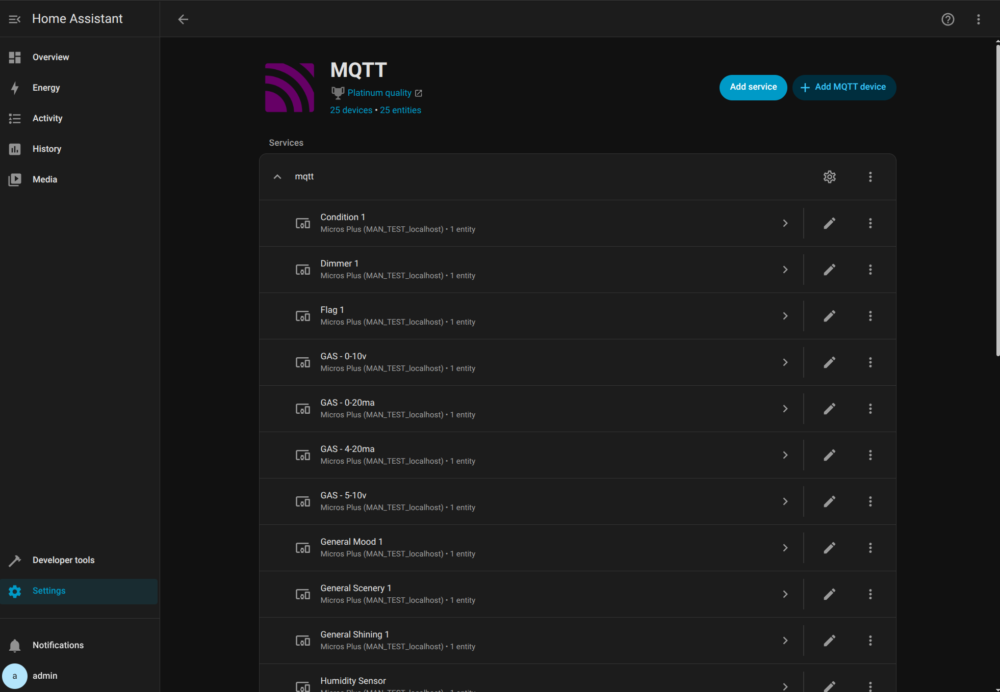
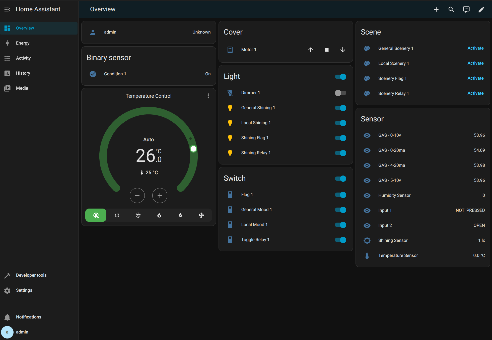
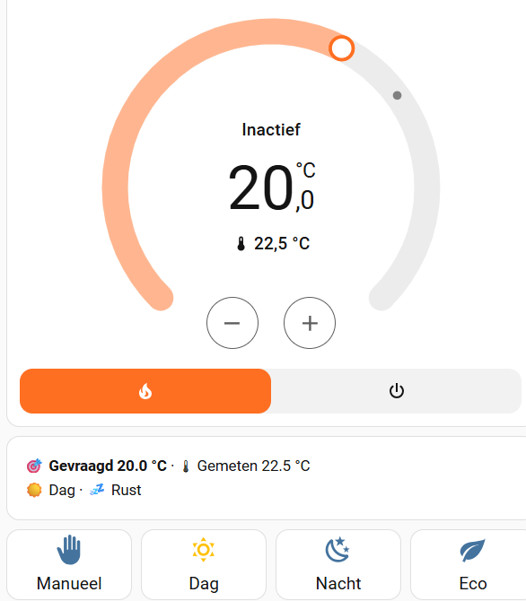

# Jeletask

An open source java API for Teletask domotics.

It is the purpose to create a MQTT bridge for software developers or domotics enthusiasts, 
who are interested in generating their own control environment for the TELETASK domotics systems,
so you can create your own user interface and connected solutions and services.

If you own a Teletask MICROS+, you need the (paid) DLL32 LIBRARY (TDS15132).  
However, if you're a java programmer like myself, you don't want to use windows dlls :-).

Teletask documentation on how their API works can be found here: https://teletask.be/media/3109/tds15132-library.pdf

The program supports the MICROS+ (maybe also NANOS/PICOS, but untested), but you'll have to buy a licence to be able to make TCP calls.

You can find the latest docker images at: https://hub.docker.com/r/ridiekel/jeletask2mqtt

# Upgrading from previous version

The 5.x branch does contain some changes that might be breaking, depending on your local setup.
So when upgrading from a previous version, please make sure to take this into account:

1. When updating your container, please remove it and recreate it when using portainer (https://github.com/ridiekel/jeletask/issues/32#issuecomment-3536714894).
2. You will have to remove your teletask device in HA before upgrading.

Upgrading to 6.4 needs no configuration changes, but `TEMPERATURECONTROL` sensors behave differently in two ways:

1. An OFF thermostat now shows as `off` in Home Assistant, without a target temperature, instead of its last mode.
2. A command with `"state": "ON"` and a mode, preset or fan speed now switches an OFF thermostat on. Home Assistant always sends that state, so `set_fan_mode` on an OFF zone turns it on too.

# Configuring

## Teletask2MQTT

Create a configuration json file following this example.
At this time I can only test with MICROS_PLUS. Please log an issue when you are having trouble with the other types of central unit.
If teletask has not changed their binary API, it should be compatible.

`type` can be either `PICOS`, `NANOS`, `MICROS_PLUS`

`device` can be used to group devices in the MQTT addons page.
This is just a description, repeating it (like in the example) will group everything with the same description.
`TELETASK_PUBLISH_ASONEDEVICE` needs to be set to `false` for this to work.

<details>
  <summary>Example config (click me)</summary>

```json
{
  "type": "MICROS_PLUS",
  "componentsTypes": {
    "RELAY": [
      {
        "number": 1,
        "description": "Power outlet",
        "type": "switch"
      },
      {
        "number": 23,
        "description": "Living Room - Closet lights",
        "type": "light"
      },
      {
        "number": 36,
        "description": "Living room - ceiling lights",
        "type": "light"
      }
    ],
    "SENSOR": [
      {
        "number": 1,
        "description": "Light Sensor",
        "type": "LIGHT",
        "device": "Sensors"
      },
      {
        "number": 2,
        "description": "General Analog Sensor 1",
        "type": "GAS",
        "gas_type": "4-20ma",
        "gas_min": 0,
        "gas_max": 14,
        "decimals": 2,
        "device": "Sensors"
      },
      {
        "number": 3,
        "description": "Temperature Sensor",
        "type": "TEMPERATURE",
        "ha_unit_of_measurement": "°C",
        "device": "Sensors"
      },
      {
        "number": 4,
        "description": "HVAC / AC",
        "type": "TEMPERATURECONTROL"
      },
      {
        "number": 5,
        "description": "Aurus wall switch in the attic",
        "type": "TEMPERATURECONTROL"
      },
      {
        "number": 6,
        "description": "Pulse counter energy Airco",
        "type": "PULSECOUNTER"
      }
    ],
    "COND": [
      {
        "number": 1,
        "description": "Condition Example"
      }
    ],
    "FLAG": [
      {
        "number": 6,
        "description": "Flag Example"
      }
    ],
    "GENMOOD": [
      {
        "number": 1,
        "description": "All off",
        "device": "Moods"
      },
      {
        "number": 2,
        "description": "Downstairs off",
        "type": "scene",
        "device": "Moods"
      }
    ],
    "MOTOR": [
      {
        "number": 1,
        "description": "Blinds"
      }
    ],
    "LOCMOOD": [
      {
        "number": 1,
        "description": "Watch TV",
        "device": "Moods"
      },
      {
        "number": 2,
        "description": "Romantic Dinner",
        "type": "scene"
      }
    ],
    "TIMEDMOOD": [
      {
        "number": 1,
        "description": "Outdoor light"
      },
      {
        "number": 2,
        "description": "Garage lights",
        "type": "scene"
      }
    ],
    "DIMMER": [
      {
        "number": 1,
        "description": "Spots"
      }
    ],
    "INPUT": [
      {
        "number": 42,
        "description": "State of TDS12117 input nr 42",
        "long_press_duration_millis": 2000
      },
      {
        "number": 43,
        "description": "State of TDS12117 input nr 43"
      }
    ],
    "TIMEDFNC": [
      {
        "number": 3,
        "description": "Timed function nr 3 (pulse for garage door)"
      },
      {
        "number": 4,
        "description": "Timed Function 4",
        "type": "scene"
      }
    ],
    "DISPLAYMESSAGE": [
      {
        "number": 1000,
        "bus_numbers": "1,1",
        "address_numbers": "13,5",
        "description": "Aurus living room + aurus basement"
      }
    ]
  }
}
```

</details>

More detailed info can also be found in:

[MESSAGES.md](MESSAGES.md)

## Prosoft

### Inputs

For input to work correctly, you have to enable `Edge triggered`.

I also had to create dummy flags for my inputs, otherwise the central would silently uncheck the `Edge triggered` checkbox.
Maybe this was a bug in one of their versions.



### One DoIP connection, PROSOFT downloads

On my MICROS+ only one DoIP (TCP) client can be connected at a time: when I tried a second connection from a
PC while the bridge was running, it was dropped immediately. So don't test the API with another tool while the
bridge is connected, stop the bridge first.

After a download from PROSOFT the central can drop its DoIP connections. If states stop updating in Home
Assistant afterwards, restart the bridge. A function you just added in PROSOFT (e.g. a new flag) stays `unknown`
in Home Assistant until it was downloaded to the central and the bridge has read its state: at the next forced
refresh (`TELETASK_PUBLISH_STATES_INTERVAL`, every 5 minutes by default) or when the bridge restarts. Adding a
function to `config.json` always needs a restart, because the bridge reads that file at startup.

# Running

## Environment variables

| Variable                                         | Type     | Default value | Description                                                                                                                                                                 |
|--------------------------------------------------|----------|---------------|-----------------------------------------------------------------------------------------------------------------------------------------------------------------------------|
| TELETASK_CENTRAL_HOST                            | Required |               | The ip address or hostname of your central unit                                                                                                                             |
| TELETASK_CENTRAL_PORT                            | Required |               | The port of your central unit, probably `55957`                                                                                                                             |
| TELETASK_CENTRAL_ID                              | Required |               | The id used in mqtt messages of the central unit                                                                                                                            |     
| TELETASK_MQTT_HOST                               | Required |               | The host of your MQTT broker                                                                                                                                                |     
| TELETASK_MQTT_PORT                               | Optional | 1883          | The port of your MQTT broker                                                                                                                                                |     
| TELETASK_MQTT_USERNAME                           | Optional | <empty>       | The MQTT broker username                                                                                                                                                    |
| TELETASK_MQTT_PASSWORD                           | Optional | <empty>       | The MQTT broker password                                                                                                                                                    |
| TELETASK_MQTT_CLIENTID                           | Optional | teletask2mqtt | The client id used for connecting to MQTT                                                                                                                                   |
| TELETASK_MQTT_PREFIX                             | Optional | teletask2mqtt | The MQTT message topic prefix                                                                                                                                               |
| TELETASK_MQTT_RETAINED                           | Optional | false         | Whether state messages are retained by the broker. Discovery config and availability are always retained, the ping never.                                                   |
| TELETASK_MQTT_DISCOVERY_PREFIX                   | Optional | homeassistant | The MQTT home assistant discovery prefix                                                                                                                                    |
| TELETASK_MQTT_EXIT_ON_DISCONNECT                 | Optional | false         | Stop the container (return code 5) when the mqtt connection is lost. Make sure your restart config is set (always or unless-stopped).                                       |
| TELETASK_PUBLISH_MOTOR_POSITION                  | Optional | true          | Publish the position of the motor                                                                                                                                           |
| TELETASK_PUBLISH_MOTOR_POSITION_INTERVAL         | Optional | 250           | How frequently the position is published when the motor is running (in milliseconds).                                                                                       |
| TELETASK_PUBLISH_STATES_INTERVAL                 | Optional | 300           | How frequently the states are force refreshed (in seconds). A negative value disables the force refresh of states.                                                          |
| TELETASK_PUBLISH_ASONEDEVICE                     | Optional | false         | Registers as one device under the HA MQTT configuration.                                                                                                                    |
| TELETASK_LOG_HACONFIG_ENABLED                    | Optional | true          | (Advanced) Log the homeassistant config messages                                                                                                                            |
| TELETASK_LOG_TOPIC_ENABLED                       | Optional | false         | (Advanced) Add the topic name to the log message                                                                                                                            |
| LOGGING_LEVEL_IO_GITHUB_RIDIEKEL_JELETASK_MQTT   | Optional | INFO          | (Advanced) log level of messages going from/to teletask central unit. <br/>Can be `ERROR` (least log messages), `WARN`, `INFO`, `DEBUG` or `TRACE` (extensive log messages) |
| LOGGING_LEVEL_IO_GITHUB_RIDIEKEL_JELETASK_CLIENT | Optional | INFO          | (Advanced) log level of messages going from/to mqtt. <br/>Can be `ERROR` (least log messages), `WARN`, `INFO`, `DEBUG` or `TRACE` (extensive log messages)                  |
| SPRING_OUTPUT_ANSI_ENABLED                       | Optional | Always        | To disable log coloring, set this value to `Detect` or `Never`                                                                                                              |

## Docker run

### Versions

Different versions (tags) are provided.

The image is now built using multiarch setup (since 5.x.x).
Docker will automatically use the correct image for your architecture.

For a native image (faster startup, less memory) use the following. It is built for both Intel/AMD (64bit) and ARM64 (raspberry pi, mac, ...) and runs on any CPU of those architectures:

    ridiekel/jeletask2mqtt:latest-native

The older tags `latest-native-amd64`, `latest-native-amd64-v1`, `latest-native-amd64-v2`, `latest-native-amd64-v3` and `latest-native-arm64` still receive updates for now, but will be removed. Please switch to `latest-native`.

If the native image fails, use the following (but slower and more resource hungry):

    ridiekel/jeletask2mqtt:latest

Both images run as a non-root user (the JVM image since 6.1.1, as user `65532`), so the mounted `config.json` must be readable by other users (for example `chmod 644 config.json`).
The JVM image is distroless: it contains no shell, so `docker exec -it jeletask2mqtt sh` does not work.

### Command line

You should be able to run using following minimal command:

```shell
docker run --name jeletask2mqtt \
  -v "<path_to_your_confg_json>:/teletask2mqtt/config.json" \
  -e TELETASK_CENTRAL_HOST="<teletask_central_ip_address>" \
  -e TELETASK_CENTRAL_PORT="<teletask_central_port>" \
  -e TELETASK_CENTRAL_ID="<teletask_central_id>" \
  -e TELETASK_MQTT_HOST="<mqtt_host>" \
  ridiekel/jeletask2mqtt:latest
```

### Docker compose

In this example you can see we added and MQTT server.
Usually you would already have that in your network.
In that case you can remove the mqtt service from the docker-compose file and point the `TELETASK_MQTT_HOST` variable to the correct host.

```yaml
services:
  mqtt:
    image: eclipse-mosquitto
    restart: unless-stopped
    volumes:
      - $HOME/.jeletask/mosquitto/data:/mosquitto/data
      - $HOME/.jeletask/mosquitto/logs:/mosquitto/logs
    ports:
      - "1883:1883"
    networks:
      - jeletask
    command: "mosquitto -c /mosquitto-no-auth.conf" #Needed for unauthenticated mqtt broker with listen address 0.0.0.0

  jeletask2mqtt:
    image: ridiekel/jeletask2mqtt:latest-native
    restart: unless-stopped
    volumes:
      - $HOME/.jeletask/teletask2mqtt/config.json:/teletask2mqtt/config.json
    environment:
      TELETASK_CENTRAL_HOST: 192.168.0.123
      TELETASK_CENTRAL_PORT: 55957
      TELETASK_CENTRAL_ID: my_teletask
      TELETASK_MQTT_HOST: mqtt
    depends_on:
      - mqtt
    networks:
      - jeletask

networks:
  jeletask:
```

If you already have an MQTT server running somewhere, you can remove the mqtt service from the docker-compose.yml.
Point the config to your mqtt instance.

## Home Assistant OS (local add-on)

On Home Assistant OS you can run the bridge as a local add-on next to the Mosquitto broker add-on.
Create a folder `/addons/jeletask2mqtt/` (e.g. with the Samba or SSH add-on) with three files:

`config.yaml`

```yaml
name: "Jeletask2MQTT"
description: "Teletask DoIP to MQTT bridge"
version: "1.0.0"
slug: "jeletask_mqtt_bridge"
arch:
  - amd64
  - aarch64
startup: services
boot: auto
```

`Dockerfile`

```dockerfile
FROM ridiekel/jeletask2mqtt:6.3.2-native

COPY --chmod=644 config.json /teletask2mqtt/config.json

ENV TELETASK_CENTRAL_HOST="192.168.0.200"
ENV TELETASK_CENTRAL_PORT="55957"
ENV TELETASK_CENTRAL_ID="1"
ENV TELETASK_MQTT_HOST="core-mosquitto"
ENV TELETASK_MQTT_PORT="1883"
ENV TELETASK_MQTT_USERNAME="<mqtt user>"
ENV TELETASK_MQTT_PASSWORD="<mqtt password>"
ENV TELETASK_MQTT_RETAINED="true"
```

and your `config.json`. Then go to Settings → Apps (Add-ons in older versions) → store → ⋮ → Check
for updates; the add-on appears under "Local".

`config.json` is copied into the image when the add-on is built. After changing it (or the Dockerfile), use
**Rebuild** on the add-on page: a restart keeps running the old configuration. Keep the folder out of shared
backups/repositories, as the Dockerfile contains your MQTT password.

A Rebuild also pulls the image again, so with a `latest` tag every configuration change could upgrade the bridge as
well. That is why the `FROM` line names a version: use the [current one](https://hub.docker.com/r/ridiekel/jeletask2mqtt/tags),
and raise it yourself after reading [the upgrade notes](#upgrading-from-previous-version). If the native image fails,
use the tag without `-native` (see [Versions](#versions)).

# Health check

The service sends an `online` message every minute.
This availability message is always retained, regardless of `TELETASK_MQTT_RETAINED`.
The Home Assistant discovery config is always retained as well, so Home Assistant finds the entities after a restart even when the bridge is reconnecting at that moment.
On startup the service clears the retained config of components that are no longer in its configuration, so Home Assistant removes those entities instead of bringing them back.
To also find its old config after `TELETASK_CENTRAL_ID`, `TELETASK_MQTT_PREFIX` or `TELETASK_MQTT_DISCOVERY_PREFIX` changed, it keeps the list of config topics it published retained on `teletask2mqtt/bridges/<TELETASK_MQTT_CLIENTID>/discovery`.
This does not work when `TELETASK_MQTT_CLIENTID` changes as well.
When the service disappears without disconnecting (crash, kill, network or power loss), the broker publishes `offline` as the last will, so Home Assistant marks all entities unavailable.

Both images (`latest` and `latest-native`) have a Docker `HEALTHCHECK`, so `docker ps` shows the container as `healthy` or `unhealthy`.
The container is healthy when:

- it is connected to the central unit,
- it is connected to the MQTT broker and the last MQTT ping (sent every minute) came back.

The check starts after a grace period of 2 minutes and runs every 30 seconds; after 3 failed checks in a row the container is marked `unhealthy`.
To see why, run:

```shell
docker inspect --format '{{json .State.Health}}' jeletask2mqtt
```

# HomeAssistant

Auto configuration should work with relays, dimmers, motors, sensors, timed functions, flags, general/local/timed moods, conditions and digital inputs.
Other types are not yet supported, work in progress.
Please log an issue when having trouble with auto configuration in HA.

By default, the bridge creates 1 device for each entry in your `config.json` and adds 1 entity with the following entity id pattern: ```light.teletask_<TELETASK_CENTRAL_ID>_<FUNCTION_TYPE>_<COMPONENT_NUMBER>```, which should be unique for your installation.

If you want to group everything under 1 device, set the `TELETASK_PUBLISH_ASONEDEVICE` environment variable to `true`. 



Examples:

```
switch.teletask_my_teletask_relay_1
light.teletask_my_teletask_relay_36
```

After that, you overview in HA should look something like this:



## Tips for automations

- When the bridge loses its connection (or restarts), all entities become `unavailable` and then come back with
  their current state. A state trigger without `from` then fires as if the flag or input changed. For triggers
  that should react to a real change (e.g. a flag set by a button), exclude those states. This works for inputs too,
  which have other states than `on` and `off`:

  ```yaml
  triggers:
    - trigger: state
      entity_id: switch.teletask_1_flag_10
      not_from: ["unavailable", "unknown"]
      not_to: ["unavailable", "unknown"]
  ```

- Digital inputs report `OPEN` / `CLOSED` in capitals; state comparisons in Home Assistant are case sensitive,
  so `is_state('sensor.teletask_1_input_33', 'OPEN')`, not `'open'`. With `long_press_duration_millis` in the
  config, the states are `NOT_PRESSED`, `SHORT_PRESS` and `LONG_PRESS` instead.
- Changing the `type` of a component can change its Home Assistant platform, e.g. a sensor from `TEMPERATURE`
  (`sensor.`) to `TEMPERATURECONTROL` (`climate.`). The old entity disappears together with its history link, so
  check dashboards and automations that used it. The room temperature is then the `current_temperature`
  attribute of the climate entity; a template sensor gives you a `sensor.` again for graphs and statistics.

# MQTT

For more information on setting and getting state using MQTT (if you want to do this manually), please see the [MESSAGES.md](MESSAGES.md) file.

## Additional HA config

### Suggested Area

You can suggest an area where the devices are located.
Example:

```json
{
  "RELAY": [
    {
      "number": 1,
      "description": "Power outlet",
      "suggested_area": "Living room"
    }
  ]
}
```

### Types

The default type of relay is ```light```, for moods and other "on/off" devices, it is ```switch```, but can be overridden.
Possible values: https://www.home-assistant.io/docs/mqtt/discovery/#lighting

```json
{
  "RELAY": [
    {
      "number": 1,
      "description": "Power outlet",
      "type": "switch"
    },
    {
      "number": 23,
      "description": "Living Room - Closet lights",
      "type": "light"
    },
    {
      "number": 36,
      "description": "Living room - ceiling lights",
      "type": "light"
    }
  ]
}
```

### Thermostats (TEMPERATURECONTROL)

A `TEMPERATURECONTROL` sensor becomes a Home Assistant `climate` entity with the current and target temperature,
and modes. While the thermostat is OFF, HA shows mode `off` and no target temperature. The following optional keys
tune the HA entity:

| Key                | Default                                  | Description                                                                                                   |
|--------------------|------------------------------------------|---------------------------------------------------------------------------------------------------------------|
| `ha_modes`         | all modes                                | HVAC modes offered in HA, e.g. `heat,off` for radiator zones                                                  |
| `ha_preset_modes`  | empty                                    | Presets offered in HA, `PRESET` or `Label=PRESET` (DAY, NIGHT, ECO, FROST, MANUAL); empty = no presets       |
| `ha_hvac_action`   | `false`                                  | Show the heat/cool demand as `hvac_action` (heating / idle / off); only observed on a heating-only MICROS+   |
| `ha_fan_modes`     | `auto,low,medium,high`                   | Fan modes offered in HA; empty = no fan control (e.g. radiator zones)                                        |
| `ha_min_temp`      | `10`                                     | Lowest target temperature in HA                                                                               |
| `ha_max_temp`      | `30`                                     | Highest target temperature in HA                                                                              |

Example for a radiator zone on an Aurus wall panel, with your own preset labels:

```json
{
  "number": 9,
  "description": "Office thermostat",
  "type": "TEMPERATURECONTROL",
  "ha_modes": "heat,off",
  "ha_min_temp": 5,
  "ha_fan_modes": "",
  "ha_preset_modes": "Manual=MANUAL,Comfort=DAY,Night=NIGHT,Eco=ECO",
  "ha_hvac_action": true,
  "ha_unit_of_measurement": "°C"
}
```

The day/night/eco preset temperatures can be changed over MQTT with the `DAY_PRESET`, `NIGHT_PRESET` and `ECO_OFFSET`
actions (see [MESSAGES.md](MESSAGES.md)), e.g. from an MQTT `number` entity in Home Assistant.

A radiator zone (`ha_modes: heat,off`, Dutch preset labels via `ha_preset_modes`) on a Home Assistant dashboard:
the standard thermostat card, plus a status line and preset buttons built on the climate entity's attributes.



# Developing

## Running

You can test the code against an in memory central unit test server (digital twin).
This test server mocks commands and events sent to and received from the teletask central.

In the test source tree, there is a `io.github.ridiekel.jeletask.Teletask2MqttTestApplication` class. 
When you start that class, you should have a fully working application with 2 docker containers started in the background:
* Home assistant
* MQTT
  Also, the test server `io.github.ridiekel.jeletask.mockserver.TeletaskMockServer` is started in the background.

All three services start on a random available port that is logged in the console.

Mocks can be defined in `io.github.ridiekel.jeletask.mockserver.TeletaskMockServer`.
Mocks should already be present for the test devices that can be found in `src/test/resources/test-config.json`

## Testing

Running tests is done using:

```shell
./mvnw clean verify
```
